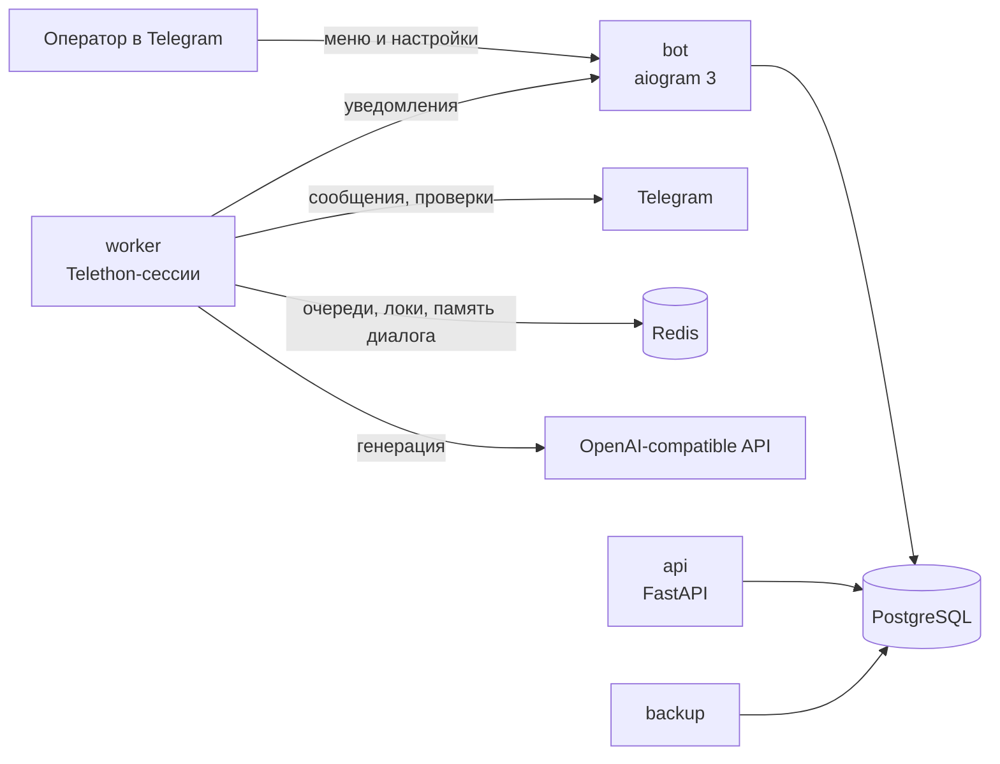

# AiGoPushTg

**Пульт управления своими Telegram-аккаунтами: AI-ответы, автопрохождение проверок, поиск и вступление в группы и каналы, мониторинг публикаций — из одного Telegram-бота.**

[](https://github.com/Asteliat/AiGoPushTg/actions/workflows/ci.yml)
[](https://www.python.org/)
[](https://aiogram.dev/)
[](https://docs.telethon.dev/)
[](https://fastapi.tiangolo.com/)
[](https://www.postgresql.org/)
[](https://redis.io/)
[](https://docs.docker.com/compose/)
[](https://docs.astral.sh/ruff/)
[](tests/)

AiGoPushTg — self-hosted система для работы с **собственными** Telegram-аккаунтами. Управление
идёт через Telegram-бота: подключаете аккаунты по QR-коду или номеру телефона, назначаете
AI-агента и персону, выбираете чаты и каналы — дальше фоновый воркер отвечает в переписках,
проходит проверки «вы не бот», ищет и вступает в сообщества, следит за публикациями каналов.

Всё разворачивается одной командой через Docker Compose на своём сервере: данные в PostgreSQL,
состояние фоновых процессов в Redis, Telegram-сессии в приватном volume.

## Содержание

- [Возможности](#возможности)
- [Как это работает](#как-это-работает)
- [Архитектура](#архитектура)
- [Быстрый старт](#быстрый-старт)
- [Переменные окружения](#переменные-окружения)
- [Управление и данные](#управление-и-данные)
- [API](#api)
- [Разработка и тесты](#разработка-и-тесты)
- [Документация](#документация)
- [Переход с AtcivPerson](#переход-с-atcivperson)
- [Безопасность и ответственное использование](#безопасность-и-ответственное-использование)

## Возможности

### 👤 Аккаунты
- Подключение по QR-коду или номеру телефона
- Работа напрямую или через SOCKS5/HTTP-прокси
- Изолированные Telegram-сессии на каждый аккаунт
- Пауза, включение и отключение без потери сессии
- Редактирование имени, username, BIO, фото и истории

### 🤖 AI и стиль
- AI-агенты через любой OpenAI-compatible API
- Персоны, примеры ответов и правила общения
- Вероятности ответа и паузы отдельно для упоминаний, личек и самостоятельных ответов
- Обучение стилю на истории переписки и материалах каналов
- Триггеры по словам: глобальные и для конкретного аккаунта

### 💬 Чаты и каналы
- Поиск групп и каналов и подтверждение вступления
- Индивидуальное включение нужных чатов
- Мониторинг публикаций каналов и анализ комментариев
- Публикация своего комментария от имени аккаунта
- История анализов по каждому каналу

### 🛡 Проверки Telegram
- Сам нажимает кнопку проверки в группе
- Сам открывает бота проверки, отправляет `/start` и подтверждает
- Реагирует только на проверки, адресованные вашему аккаунту
- Чужие проверки игнорируются молча
- Режимы: авто, только уведомлять, не реагировать
- Подробнее: [docs/CHALLENGES.md](docs/CHALLENGES.md)

**📊 Наблюдаемость**
- Уведомления о событиях с маршрутизацией по категориям (основные, ответы, ошибки, обучение, каналы)
- Приватный HTTP API для сбора сведений об аккаунтах, агентах и персонах
- Ежедневные резервные копии PostgreSQL с ротацией

## Как это работает



1. **Бот** принимает настройки и хранит их в PostgreSQL. Каждое действие — отдельный экран с
   подменю, привязкой к аккаунту и понятными подписями.
2. **Воркер** поднимает Telethon-сессии аккаунтов (по одной на процесс: сессию защищает Redis-lease),
   слушает выбранные чаты, проходит проверки и публикует комментарии в каналах.
3. **Redis** хранит аренду сессий, блокировки, кулдауны и краткую память диалога; всё это можно
   потерять без потери данных — оно пересоздаётся.
4. **AI** вызывается только когда сработали настройки: вероятность, триггер, адресация или
   включённый мониторинг канала.

## Архитектура

| Компонент | Роль |
| --- | --- |
| **bot** | Интерфейс управления: `app/bot/core.py`, навигация в `navigation.py`, экраны в `app/bot/screens/` |
| **worker** | Обработка аккаунтов и каналов: `app/workers/` — состояние, подключение, конвейер ответов, проверки, мониторинг |
| **api** | Внутренний HTTP API (`app/api/`) |
| **migrate** | Применение схемы базы данных |
| **postgres** | Постоянное хранилище |
| **redis** | Координация воркеров, блокировки, временные данные |
| **backup** | Ежедневный дамп PostgreSQL |

| Технология | Назначение |
| --- | --- |
| Python 3.12 | Язык приложения |
| aiogram 3 | Управляющий бот |
| Telethon | Пользовательские сессии |
| FastAPI | HTTP API |
| PostgreSQL 17 + SQLAlchemy 2 (asyncpg) | Данные |
| Redis 7 | Координация |
| Docker Compose | Запуск |
| Ruff + pytest | Качество и тесты |

## Быстрый старт

**Требования:** Linux-сервер или локальная машина с Docker Engine и Compose plugin; бот от
[@BotFather](https://t.me/BotFather); `api_id` и `api_hash` с [my.telegram.org](https://my.telegram.org);
ваш Telegram ID; доступ к OpenAI-compatible провайдеру, если нужны AI-ответы.

```bash
# 1. Код
git clone https://github.com/Asteliat/AiGoPushTg.git
cd AiGoPushTg

# 2. Окружение
cp .env.example .env
nano .env        # заполните BOT_TOKEN, ADMIN_IDS, TELEGRAM_API_ID/HASH, пароли и секреты

# 3. Запуск
docker compose up --build -d
```

Проверка и первый вход:

```bash
docker compose ps
docker compose logs --tail=100 bot worker api
curl -s http://127.0.0.1:8080/health
```

Откройте своего бота и отправьте `/start` — панель доступна только ID из `ADMIN_IDS`.
Дальше: **Аккаунты → ➕ Добавить аккаунт → QR-код** (или номер телефона), затем назначьте
AI-агента, персону и включите нужные чаты.

## Переменные окружения

| Переменная | Обязательна | Описание |
| --- | --- | --- |
| `BOT_TOKEN` | да | Токен управляющего бота |
| `ADMIN_IDS` | да | Telegram ID администраторов через запятую |
| `TELEGRAM_API_ID` | да | `api_id` приложения Telegram |
| `TELEGRAM_API_HASH` | да | `api_hash` приложения Telegram |
| `POSTGRES_PASSWORD` | да | Пароль PostgreSQL |
| `DATABASE_URL` | да | Строка подключения; пароль должен совпадать с `POSTGRES_PASSWORD` |
| `REDIS_URL` | да | Строка подключения к Redis |
| `API_SECRET_KEY` | да | Секрет для защищённых endpoints API |
| `PROXY_ENCRYPTION_KEY` | да | Ключ шифрования прокси; **не меняйте после сохранения прокси** |

Не используйте заглушки из `.env.example` в рабочей среде. `.env` не должен попадать в Git.

## Управление и данные

- `.env` — секреты конкретного окружения.
- Имена Docker-проекта и volumes заданы явно (`aigopushtg`), поэтому каталог с кодом можно
  называть как угодно — данные останутся на месте.
- Volume `aigopushtg_app_data` — данные приложения и Telegram-сессии.
- Volumes `aigopushtg_postgres_data`, `aigopushtg_redis_data` — база и координация.
- `backups/` — ежедневные дампы PostgreSQL (ротация 14 дней).
- Не удаляйте volumes при обновлении: это потеря базы, авторизаций и рабочих данных.

**Меню бота:** 👤 Аккаунты · 🤖 ИИ-агенты · 🎭 Персоны · 💡 Примеры · 🧰 Инструменты · ⚙️ Настройки ·
🛡 Проверки · 🧾 Логи. Карточка аккаунта разложена на «ИИ и агент», «Обучение», «Чаты и каналы»,
«Профиль и прокси» — плюс переключение между аккаунтами стрелками.

## API

По умолчанию слушает только `127.0.0.1:8080`.

| Endpoint | Описание |
| --- | --- |
| `GET /health` | Состояние сервиса |
| `GET /v1/accounts` | Аккаунты |
| `GET /v1/agents` | AI-агенты |
| `GET /v1/personas` | Персоны |
| `/docs` | Интерактивная документация |

```bash
curl http://127.0.0.1:8080/health
curl -H "X-API-Key: $API_SECRET_KEY" http://127.0.0.1:8080/v1/accounts
```

Не выставляйте API в интернет без TLS и контроля доступа.

## Разработка и тесты

```bash
python -m venv .venv
source .venv/bin/activate
python -m pip install -e ".[dev]"

ruff check app tests --select F
pytest -q
```

CI (`.github/workflows/ci.yml`) прогоняет эти же проверки на каждый push и pull request в `main`.

```
app/
├── bot/          # aiogram: роутер, навигация, экраны, общий поиск сообществ
├── workers/      # Telethon-воркер: состояние, подключение, конвейер, проверки, каналы
├── services/     # бизнес-логика без Telegram: проверки, каналы, триггеры, уведомления
├── telegram_gateway/  # поиск сообществ, управление сессиями, прокси
├── storage/      # модели и доступ к базе
└── api/          # FastAPI
tests/            # 374 теста: чистая логика, фейки Telegram/Redis/БД
```

## Документация

- [Автопрохождение проверок Telegram](docs/CHALLENGES.md) — какие проверки считаются «своими»,
  оба сценария (кнопка в группе и переход в бота), режимы, ограничения, как проверить.
- [Вход в Telegram-аккаунт по номеру телефона](docs/PHONE_LOGIN.md)
- [Пользовательское руководство](https://guide.cloudre.store/)

## Переход с AtcivPerson

Проект переименован, и вместе с ним сменились PostgreSQL-пользователь и база (`aigopushtg`),
а Docker-проект теперь зафиксирован как `aigopushtg` — каталог можно называть как угодно.

Старая установка не совместима с новой базой, поэтому есть два пути.

**Чистая установка (проще):**

```bash
# в каталоге старого бота
docker compose down -v          # удаляет volumes: база, Redis, Telegram-сессии

# новый бот в любом каталоге
git clone https://github.com/Asteliat/AiGoPushTg.git
cd AiGoPushTg && cp .env.example .env && nano .env
docker compose up --build -d
```

После этого аккаунты нужно подключить заново (Telegram-сессии жили в volume `app_data`),
а AI-агентов, персоны и каналы — настроить через бота.

**С переносом данных:** сделайте дамп из старого бота (`docker compose exec -T postgres pg_dump -U
atcivperson -d atcivperson -Fc > old.dump`), поднимите новый, примените схему и загрузите дамп в
`aigopushtg` — либо перенесите только нужные таблицы. Файлы сессий из `app_data` старого volume
тоже можно скопировать в новый volume, если хотите сохранить авторизации.

## Безопасность и ответственное использование

- Подключайте только свои аккаунты или те, на использование которых у вас есть разрешение.
- Соблюдайте [условия Telegram](https://telegram.org/tos) и правила сообществ.
- Не используйте проект для спама, обмана людей или обхода ограничений платформы.
- Храните `.env`, ключи, бэкапы и session-файлы вне публичного доступа; ограничьте доступ к серверу.
- Перед включением автоматических действий проверьте их на тестовом аккаунте в контролируемом чате.
- Telegram может ограничивать действия аккаунтов независимо от настроек приложения.
